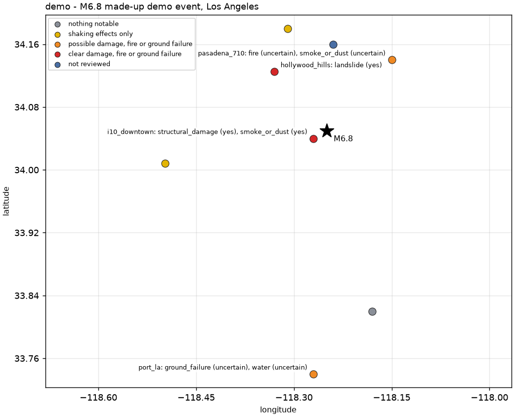

# eqcam

Rapid survey of camera videos after an earthquake with vision-language models. Given the videos of public or
traffic cameras recorded around an event (for example, downloaded by a server triggered by ShakeAlert through
PDL), eqcam finds when the shaking reaches each camera (the camera's vibration), picks the frames before, during
and after it, and has a vision-language model look for its effects:

- structural damage, infrastructure damage (bridges, roads, poles and wires)
- landslides and rockfall, ground failure (cracks, liquefaction, surface rupture)
- fire, smoke or dust, power outages, water (flooding, sloshing, seiche), people's response
- shaking intensity (a Modified Mercalli range from the visible effects, or an upper bound when the scene could
  show effects but shows none, with a confidence)

The result is a table and a map, with a severity (0-3), a confidence and a one-line summary per camera.

## Pipeline

```
videos.csv + videos + event.json
  -> eqcam prepare   motion of each video (image shifts by phase correlation): the stable views between the
                     camera panning, zooming or switching views; the camera vibration (the image jittering back
                     and forth within a view, when the shaking arrives): onset, peak, end; whether the
                     camera's mount resonates (dominant frequency, ring-down, damping); frames BEFORE /
                     PEAK SHAKING / AFTER / LATEST in the
                     same view, in a labeled 2 x 2 tile; flags (no video, dark or frozen at the end, camera
                     moved, scene changed, view changes, latest in another view)
  -> eqcam review    one request per camera (the tile and the motion in words) to a backend, in parallel;
                     structured JSON findings; an optional second stage on the cameras the first one flagged
  -> eqcam report    survey.csv, survey.json, map.html (Leaflet), map.png
```

`eqcam run` does all three. Outside events, `eqcam calibrate` builds a catalog of the cameras from routine clips
(see [Calibration](#calibration-before-events)). The Claude Code skill in `.claude/skills/eqcam/` runs the same steps and can also do
the review in the session itself (no API key), for testing: see [Testing with the Claude Code
skill](#testing-with-the-claude-code-skill).

## Install

```bash
pip install -e .                    # numpy, scipy, matplotlib, pillow; ffmpeg and ffprobe on the PATH
pip install -e ".[claude]"          # Claude through the Anthropic API or Vertex AI
pip install -e ".[gemini]"          # Gemini through Vertex AI
pip install -e ".[record]"          # yt-dlp, to record YouTube live streams (calibrate --streams, eqcam record)
pip install -e ".[test]" && pytest  # tests need no API
```

## Usage

An event, step by step (`eqcam <command> -h` lists every option):

```bash
eqcam prepare --cameras videos.csv --videos <folder> --event event.json --out runs/E
eqcam review  --out runs/E --backend claude          # or gemini, qwen; see Backends
eqcam report  --out runs/E [--vibration]             # --vibration: the vibration and arrivals maps and data
```

or all at once, with an optional second model on the cameras the first one flags:

```bash
eqcam run --cameras videos.csv --videos <folder> --event event.json --out runs/E --backend claude \
          --model claude-haiku-5-5 --escalate-model claude-opus-5-5 [--vibration]
```

| option | command | |
|---|---|---|
| `--only ID ...` | prepare, review, run, calibrate, record | only these cameras |
| `--max-seconds` | prepare, run | the longest part of a video decoded (600 s; with `start_utc` and the event, around the predicted arrivals) |
| `--motion-fps`, `--motion-width` | prepare, run | the frames for the motion (15 fps, 320 px) |
| `--workers` | review, run, calibrate, record | requests (8) or streams (4) at a time |
| `--stage`, `--escalate-from`, `--min-severity` | review, run | name the review stage; review only the cameras an earlier stage flagged (severity 2 or more, low confidence, errors) |
| `--overwrite` | review, run | review again the cameras that have findings (otherwise they are skipped, so a run can resume) |
| `--escalate-model` | run | a second model for the flagged cameras (stage `final`) |
| `--stages` | report | the stages to take the findings from, in order (final, review, screen) |
| `--no-mask` | report, run | do not blur the people |
| `--vibration` | report, run | the vibration and the P and S arrivals, for scientific use |

`eqcam validate --out runs/E --stage review` checks findings written by hand or in a Claude Code session. Outside
events: `eqcam calibrate` and `eqcam record` (see [Calibration](#calibration-before-events)).

Before publishing, check the event in a catalog (e.g., USGS): the alert's first magnitude is often revised. Put
the catalog's magnitude in `event.json` and the event page in `url`.

## Tests and demo

Neither needs an API key, a GPU or real videos.

`pytest` runs the tests in `tests/` (about 5 s). They make synthetic videos with ffmpeg: a textured scene,
with sensor noise, shaken by a few pixels for 4 s, with a dark patch after the shaking. They check that:

- `prepare` finds the shaking at the right time and with a plausible amplitude, flags the change after it,
  makes the 2 x 2 tile, and handles a quiet camera, a missing video and a noiseless static scene;
- the findings schema accepts valid findings and lists every problem of invalid ones, and the JSON is
  recovered from a model's text (code fences, reasoning blocks);
- each backend builds the right request: Claude with a stand-in client (structured output, image, server-side
  fallbacks on the Anthropic API only, refusals), Gemini's schema, and Qwen against a local stand-in for an
  OpenAI-compatible server;
- `review` runs in parallel, skips cameras already reviewed, escalates only the flagged ones to a second
  stage, and `report` writes the table and the maps.

`python examples/demo.py` builds a made-up event to see what eqcam produces: eight cameras around Los Angeles
with synthetic videos (one without a video) and made-up findings of every severity (a collapse, a landslide,
possible liquefaction, a possible fire, shaking only, nothing). It writes `runs/demo/run/map.html`,
`map.png`, `survey.csv` and the tiles. A copy is in [`docs/demo/`](docs/demo/):



The interactive map, with a basemap and popups with each camera's findings and tile:
**<https://lijun99.github.io/eqcam/demo/map.html>**. The findings are not from a model; to test a model, see
[Testing with the Claude Code skill](#testing-with-the-claude-code-skill), or run `eqcam review` on the demo with
a backend.

GitHub Pages serves `docs/`: the start page **<https://lijun99.github.io/eqcam/>** (`docs/index.html`) links the
demo map, the event surveys (<https://lijun99.github.io/eqcam_events/>) and this repository. After a change to
the maps, refresh the demo: `python examples/demo.py --out <folder>`, then copy its `run/map.html`, `map.png`,
`survey.csv` and `cameras/*/tile.jpg` to `docs/demo/`.

## Inputs

`videos.csv` (see `examples/`):

| column | |
|---|---|
| `camera_id` | unique id |
| `name`, `view` | the camera and what it looks at (passed to the model) |
| `lat`, `lon` | location |
| `video` | path, relative to `--videos` |
| `start_utc` | optional: ISO time of the first frame; with the event, the shaking is searched near the predicted P and S arrivals |
| `video_url` | optional: the video online; the map links to it (never to the local file) |

`event.json`: `event_id`, `origin_utc`, `lat`, `lon`, `depth_km`, `magnitude`, `place` (only `event_id` required); optionally `magnitude_type`, `note` and `url`
(the event page, e.g., USGS: the magnitude and location may be revised after the alert). The epicenter's popup
on every map shows them, with the link.

## Backends

| `--backend` | Model (default) | Credentials and options |
|---|---|---|
| `claude` | `claude-opus-5-5` | Anthropic API: `ANTHROPIC_API_KEY` (or an `ant auth login` profile). Vertex AI: `--platform vertex --project P [--region global]`, Google Application Default Credentials. `--effort low/medium/high` |
| `gemini` | `gemini-2.5-flash` | Vertex AI: `--project P [--location global]`, Application Default Credentials. Check the current Gemini model names |
| `qwen` | `Qwen/Qwen3-VL-8B-Instruct` | an OpenAI-compatible server with guided JSON decoding, e.g., `vllm serve Qwen/Qwen3-VL-8B-Instruct`; `--base-url` or `EQCAM_QWEN_URL`, optional `EQCAM_QWEN_API_KEY` |

All backends get the same instructions and JSON schema (`src/eqcam/schema.py`), and their findings are checked
against it. On the Anthropic API, refusals by Claude Opus 5.5 (and the other models that support it) fall back
server-side to Anthropic's default fallback model (`fallbacks: "default"`); Vertex AI has no server-side
fallback, and a refusal is recorded as the camera's error.

Two stages, a cheap model on every camera and a stronger one on those it flags (severity 2 or more, low
confidence, or an error):

```bash
eqcam review --out runs/E --backend claude --model claude-haiku-5-5 --stage screen
eqcam review --out runs/E --backend claude --stage final --escalate-from screen
eqcam report --out runs/E                 # takes final, then review, then screen
```

## Testing with the Claude Code skill

The skill lets you try the whole pipeline before you have an API key. Claude, in a Claude Code session, does
the review step itself: it looks at each camera's tile and writes the findings in the same format as the API
backends. This uses your Claude plan, not API credits.

1. **Make the skill available.** It loads when Claude Code is started in this repository (`cd eqcam && claude`).
   To use it from another folder, such as the one with the videos, link it into your user skills:

   ```bash
   mkdir -p ~/.claude/skills && ln -s "$PWD/.claude/skills/eqcam" ~/.claude/skills/eqcam
   ```

2. **List the test videos** in a `videos.csv` (format above; `examples/` has one), with an `event.json` if you
   have the event. Useful test sets: CCTV clips of past earthquakes, and a few minutes of live streams on a quiet
   day, to see the false alarms.

3. **Run the skill** with `/eqcam` or by asking, for example:

   ```
   /eqcam survey the videos in ~/quake_clips/videos.csv (event ~/quake_clips/event.json);
   review them in this session, no API
   ```

   It runs `eqcam prepare`, reviews each tile in the session (high priority first, split among subagents
   when there are many cameras), writes `findings/review/<camera_id>.json` with `"reviewed_by": "claude-code"`,
   checks them with `eqcam validate`, and runs `eqcam report`.

4. **Check the results.** Open `runs/<event_id>/map.html` and compare each camera's findings with its tile
   (`cameras/<id>/tile.jpg`) and its video.

To compare with an API backend on the same run, review into another stage and report each in turn (the report
files are rewritten each time):

```bash
eqcam review --out runs/E --backend claude --stage api
eqcam report --out runs/E --stages api        # the API's findings
eqcam report --out runs/E --stages review     # the session's findings
```

The in-session review is for testing a few to a few tens of cameras: it is slower than the API backends and
counts against the plan's usage limits. The tiles are sent to Claude as part of the session, as with a cloud
backend. If `eqcam` is not installed in the environment, the skill runs it from the source
(`PYTHONPATH=src python -m eqcam.cli`).

## Outputs (`--out`)

- `cameras/<id>/`: `tile.jpg`, the full frames, `motion.png`, `motion.npz`; after `eqcam report`, the tile and
  frames with the people blurred and the originals in `original/`
- `metrics.json`, `tasks.json`: the motion and flags per camera, and the review tasks (high priority first)
- `findings/<stage>/<id>.json`: `{camera_id, stage, reviewed_by, model, reviewed_at, latency_s, usage, error,
  findings}`, and optionally `video_window_s: [start, end]` (s of the video) set by the reviewer
- `survey.csv`, `survey.json`, `map.html`, `map.png`; with `--vibration`, `vibration.html`, `vibration_summary.png`
  and per camera `vibration.png`, `vibration.json`, `vibration.npz`; `arrivals.html`, `arrivals_summary.png`,
  per camera `arrivals.png`, and the data in `vibration_data/` (and `vibration_data.zip`)

**The image motion is not the ground motion.** It is the ground motion filtered by the camera's mount (a pole, a
mast, a bracket, the building) and scaled by the zoom. `eqcam prepare` re-decodes the shaking and its ring-down at
the frame rate of the video and measures the dominant frequency, the fraction of the motion near it, the ring-down
(e-folding time of the envelope) and the damping. A narrow peak, lightly damped (5 % or less) and ringing 5 cycles
or more, or any motion ringing 10 s or more, is flagged `resonant_mount`: the image motion shows the mount more than
the ground (e.g., a Caltrans pole ringing at 5 Hz for 9 s or more after an M4.2 at 7 km). A broadband, quickly
damped motion may be closer to the ground shaking (a stiff mount), or come in one-sided kicks from a loose part or
the video (see the linearity, with `--vibration`). The review estimates the intensity (MMI) only from visible
effects, by a rubric of what a camera can show at each level: an estimate when it sees such effects, an upper bound
when the scene could show them (people, hanging objects, trees, water) but shows none, or not constrained; with a
confidence. The text calls the measured image motion "camera vibration" and keeps "shaking" for the ground shaking.

**Vibration (optional, for scientific use).** `eqcam report --out runs/E --vibration` (or `eqcam run ...
--vibration`) also analyzes the vibration of each camera with shaking and of the objects in its view: the shaking
and its ring-down are decoded again at the frame rate of the video, 640 px wide; a grid of patches is tracked, an
affine motion of the camera (shift, roll, scale, shear: the shear takes a rolling shutter) is fitted to them frame
by frame and robustly (each patch weighted by the quality of its match in that frame and by Tukey's biweight of its
residual, so that dark patches of sensor noise at night or blurred, blocky frames do not make a false shift or
roll), and what is left in a patch is the motion of what it shows. The camera's motion is also checked for
linearity: a mount responding linearly to the ground moves smoothly and symmetrically, while free play (a loose part
knocking), slip or video glitches give kicks (a jump within one frame), a one-sided motion and heavy tails. A camera
with at least 0.3 kicks per second and |skewness| of 1 or more, or kurtosis of 8 or more, is `impulsive (not
linear)` (`linearity` in `vibration.json`, its own color on the map): its motion gives the timing and the envelope
of the shaking, but no calibration of the mount turns it back into the ground motion. A patch that oscillates on its
own during the shaking (well above its level before, with a spectral peak, not coherent with the camera's motion,
tracked without jumps: not traffic) is a vibrating object. It writes, per camera, `vibration.png` (the frame with
the objects outlined; the displacement of the camera against time, its spectrum and spectrogram; the displacement
and spectra of the objects), `vibration.json` and `vibration.npz` (the series), and `vibration.html` (a map of the
cameras by their vibration, the figures in the popups) and `vibration_summary.png` (the dominant frequencies against
the distance, the spectra of the cameras); `map.html` links them. Displacements are in pixels: compare frequencies
and shapes across cameras, not amplitudes. It adds about 5 s per camera.

**P and S arrivals and the data (with `--vibration`).** In each camera's motion (one-frame glitches removed,
0.5-12 Hz), the onsets are the sharp rises of the motion energy; P and S are the pair of onsets whose interval
fits the expected S-P time (Vp 5.7, Vs 3.1 km/s, from the hypocentral distance; down to 25 % shorter, as P starts
small and is often picked late), with P clear of the noise and S stronger; otherwise S is the strongest onset. Each
camera is labeled "P and S", "S only" or "ambiguous". The S pick minus its predicted arrival gives the delay of the
stream; P minus its own is reported as how late P was picked (`p_late_s`). `arrivals.html` maps the cameras by the
quality of their picks, with per camera `arrivals.png` (the motion with the picks; the spectra of the noise, P and
S windows) and its data; `arrivals_summary.png` has S-P against the distance and the stream delays.
`vibration_data/` (zipped too) has, for further analysis, per camera the motion (`<id>_motion.csv`: video time,
UTC as received, across, down, roll, scale) and the spectra (`<id>_spectra.csv`), the motion of vibrating objects
if any, `cameras.json` (locations, distances, frame rates, pixel scales, mounts, picks, delays), `event.json` and a
README.

**What the camera motion is good for.** On the 2026-11-20 M3.9 (Los Angeles), five cameras were compared with the
nearest seismic stations (0.13-4.6 km): the camera spectra are the mount's response, not ground-motion spectra
(their shapes and S/P ratios did not match the stations', even 130 m away); the camera S-P times were 0.3-1 s
short, and the stream delays from the picks and from the envelopes cross-correlated with the stations differed by
0.5-1.5 s. The envelope of the shaking agreed (peak correlation 0.75-0.94). Use the camera motion for whether and
roughly when a camera shook, and for its mount frequencies; not for ground spectra, amplitudes or precise picks.
The velocities above are the stations' apparent ones at that event. At Mount Wilson (130 m from the station),
driving models of the mount (stiff, resonant, soft; sampled at the frame rate, with aliasing) with the station's
acceleration (5.8 cm/s²) gives at most 0.17 px of image motion, while the camera moved 2-4 px in one-sided kicks;
no linear model fit the waveform (at most 11 % of its variance). That camera is flagged impulsive.

**People are blurred** before the frames are published or shared: the review returns `people_boxes` (a box around
every person or group, 0-1000 of the tile) with its findings, at no extra cost, and `eqcam report` pixelates and
blurs those boxes in the tile and, through the tile layout saved by prepare, in the full frames (Pillow only;
`--no-mask` to skip). The originals stay in `cameras/<id>/original/`. The boxes are as good as the model's
localization: they are padded, and a review that misses a person leaves them visible.

`map.html` opens from the disk in a browser (it needs internet for the basemap and Leaflet). Its basemaps are
USGS The National Map (Topo and Imagery; US only; the default for US events) and CARTO Light (worldwide). It does
not use OpenStreetMap's own tile servers, which block pages opened as local files.

A panel on the map filters the cameras by what was seen: shaking, each detection of the schema, and cameras
dark, frozen or without video (any checked tag; uncertain ones with a dashed outline; the others dimmed or
hidden). Each popup links the video online (`video_url`; no link without it) opened at the part that covers the
detections (`#t=start,end`: the `video_window_s` of the review record if set, else the camera vibration detected,
else the predicted P and S arrivals) and at the times of the frames; `survey.csv` has the same window. The panels
(filter, legend) fold with a tap on their header, and start folded on phones (narrow or touch screens); they hide
while a popup is open, and popups are kept within the screen, shown from their top.

## Calibration (before events)

A periodic survey of the cameras' live streams builds a catalog of the cameras, to use at events:

```bash
pip install "eqcam[record]"           # yt-dlp, for YouTube streams
eqcam calibrate --streams calibration/streams.csv --record 180 --wind --out calibration/catalog   # e.g., every 6 h
eqcam calibrate --events runs/<event_id>/run --out calibration/catalog                         # after each event
eqcam record --streams calibration/streams.csv --seconds 180 --out recordings/                 # recording only
```

`streams.csv` is the camera list: `camera_id, name, lat, lon, stream` (a YouTube watch or live URL, read
through yt-dlp, or any URL ffmpeg reads: HLS, RTSP, HTTP) and optionally `view`. Each run records a clip of every
stream (`eqcam record`; video only, as streamed; `--record` seconds, 180) into `recordings/<UTC time>/`, with the wind at the nearest
weather station reporting it (`--wind`, api.weather.gov, US only); a stream that cannot be recorded counts as
offline. The videos are deleted after `--keep-days` (7). Run it at several times of day (day, twilight and night)
and on windy days; unattended, from a scheduler (e.g., cron, `15 */6 * * *`) on the machine that records the
streams. It needs Python 3.10+, numpy, scipy, matplotlib, pillow, ffmpeg, and yt-dlp for YouTube. If that
machine already records the streams on a schedule, keep its recorder and pass each batch of files instead:
`--clips clips.csv --videos <folder>` (the columns of `videos.csv`, and optionally `clip_id`, `start_s` and
`end_s`, the part of the video to use, and `wind_mps`), with the same `camera_id` as in the event `videos.csv`.
The catalog folder is plain JSON, CSV and PNG, easy to copy elsewhere for analysis. The Claude Code skill has
the procedure (section 5), including what to report after each run. For each clip:

- **quality**: resolution, frame rate, bitrate; brightness, contrast, sharpness (variance of the Laplacian),
  frozen frames; day, twilight or night from the elevation of the sun at the camera (else the brightness). The
  bars (`QUALITY` in `calibrate.py`: at least 480 px tall, not dark, not frozen, not blurred; for vibration at
  least 15 fps, a stable view of 20 s, a steady calm image) are provisional, to be agreed;
- **views**: fixed or touring presets, and the calm jitter of the image (as in prepare);
- **ambient vibration**: the spectrum of the image motion in the stable views at the native frame rate (wind and
  traffic shake the mount); its peaks above the local background (running median over 2 Hz), and the half-power
  width of the strongest (its damping, when wider than the resolution of 0.125 Hz); and its linearity, as in the
  shaking (kicks in calm air are glitches of the video; in wind, they can be free play).

The ambient spectrum gives a linear mount's frequencies and damping, not its gain (the force of the wind is
unknown): the gain needs a known input, such as events recorded by a nearby station. It says nothing of a mount
with free play, whose kicks start only above some acceleration.

`--events` adds what earlier events measured per camera: the mount's frequency and damping in the shaking, and, with
`report --vibration`, whether the motion was impulsive and the stream delay from the P and S arrivals. Clips and
events accumulate in the catalog folder (`clips/<camera_id>/<clip_id>.json`, `events/<event_id>.json`), and every
run rebuilds `catalog.json`, `catalog.csv` (one row per camera: uptime, day, twilight and night usable and why not,
touring, ambient peaks, clips with impulsive ambient motion, mount at events, impulsive at events, median stream
delay, notes), per camera `calibration/<camera_id>.png` (the ambient spectra of its clips, by light, with the mount
frequencies of the events) and `changes.json` (cameras new, offline or back online, no longer usable, a new ambient
peak, impulsive in the shaking). Not yet: the scene inventory (which intensity levels a view can constrain, one
model call per view), stream delays from burned-in clocks, and `prepare` reading the catalog.

On the 2026-11-20 M3.9 videos (2 min after the shaking, at night), the ambient peaks match the mount at the event
at Skid Row (2.5 Hz) and at the Caltrans pole (5 Hz, with modes at 1.1 and 2.5 Hz); not at Venice (0.5 min of
steady view between tours, a weak 1.5 Hz peak; 9.5 Hz at the event) nor at Mount Wilson (3 Hz; 8.4 Hz at the
event). Calibration needs longer and repeated clips, which routine recordings provide.

## Notes

- **Cost and time.** A 1280 x 720 tile is about 1,200 image tokens; with the text, about 2,500 input and
  300-1,000 output tokens per camera. Throughput is set by the account's rate limits (input tokens per minute)
  and `--workers`.
- **Privacy.** Frames may show people. The instructions forbid describing or identifying individuals, but the
  frames themselves go to the provider of a cloud backend; use the `qwen` backend on your own server when they
  must not leave it.
- **The motion is not a seismometer.** The camera vibration depends on the camera's mount and zoom (on the event
  of 2026-11-20, M3.9, the largest image motion, 6 px at LAX, was at one of the lowest ShakeMap intensities,
  3.0); it is used to find the shaking and pick the frames, and the intensity is estimated only from visible
  effects.
- **Status.** The prepare, review and report steps are tested with synthetic videos and stand-ins for the APIs
  (see [Tests and demo](#tests-and-demo)); the backends have not yet been run against the live services, nor
  the pipeline on real earthquake videos.
