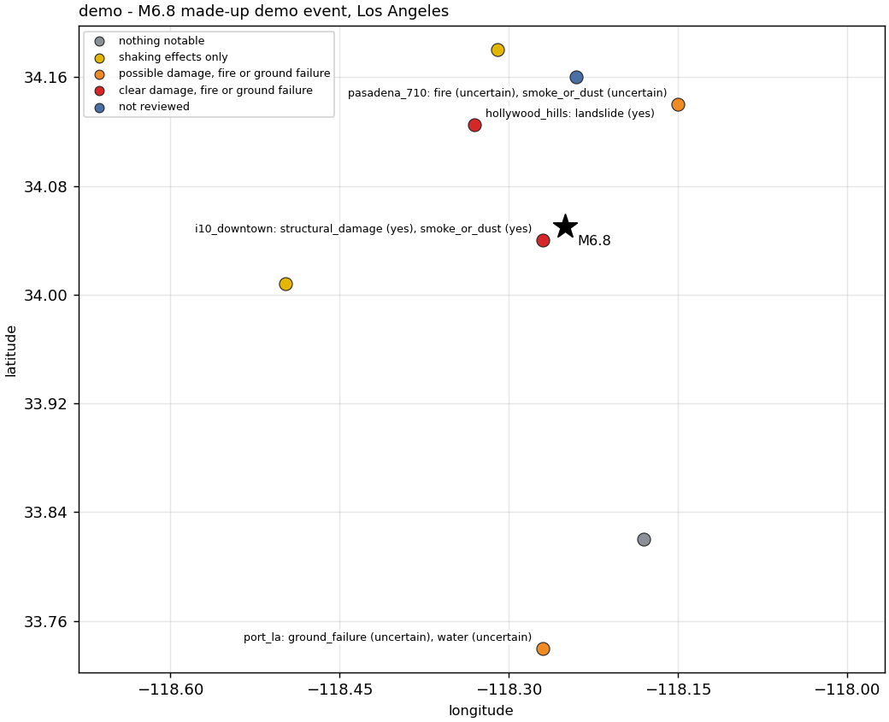

# eqcam

Rapid survey of camera videos after an earthquake with vision-language models. Given the videos of public or
traffic cameras recorded around an event (for example, downloaded by a server triggered by ShakeAlert through
PDL), eqcam finds the shaking in each video, picks the frames before, during and after it, and has a
vision-language model look for its effects:

- structural damage, infrastructure damage (bridges, roads, poles and wires)
- landslides and rockfall, ground failure (cracks, liquefaction, surface rupture)
- fire, smoke or dust, power outages, water (flooding, sloshing, seiche), people's response
- shaking intensity (a Modified Mercalli range from the visible effects)

The result is a table and a map, with a severity (0-3), a confidence and a one-line summary per camera.

## Pipeline

```
videos.csv + videos + event.json
  -> eqcam prepare   motion of each video (frame differences, image shift); onset, peak and end of the shaking;
                     frames BEFORE / PEAK SHAKING / AFTER / LATEST in a labeled 2 x 2 tile; flags
                     (no video, dark or frozen at the end, camera moved, scene changed, edited video)
  -> eqcam review    one request per camera (the tile and the motion in words) to a backend, in parallel;
                     structured JSON findings; an optional second stage on the cameras the first one flagged
  -> eqcam report    survey.csv, survey.json, map.html (Leaflet), map.png
```

`eqcam run` does all three. The Claude Code skill in `.claude/skills/eqcam/` runs the same steps and can also do
the review in the session itself (no API key), for testing: see [Testing with the Claude Code
skill](#testing-with-the-claude-code-skill).

## Install

```bash
pip install -e .                    # numpy, scipy, matplotlib, pillow; ffmpeg and ffprobe on the PATH
pip install -e ".[claude]"          # Claude through the Anthropic API or Vertex AI
pip install -e ".[gemini]"          # Gemini through Vertex AI
pip install -e ".[test]" && pytest  # tests need no API
```

## Tests and demo

Neither needs an API key, a GPU or real videos.

`pytest` runs the tests in `tests/` (about 5 s). They make synthetic videos with ffmpeg: a textured scene,
with sensor noise, shaken by a few pixels for 4 s, with a dark patch after the shaking. They check that:

- `prepare` finds the shaking at the right time and with a plausible amplitude, flags the change after it,
  makes the 2 x 2 tile, and handles a quiet camera, a missing video and a noiseless static scene;
- the findings schema accepts valid findings and lists every problem of invalid ones, and the JSON is
  recovered from a model's text (code fences, reasoning blocks);
- each backend builds the right request: Claude with a stand-in client (structured output, image, server-side
  fallbacks on the Anthropic API only, refusals), Gemini's schema, and Qwen against a local stand-in for an
  OpenAI-compatible server;
- `review` runs in parallel, skips cameras already reviewed, escalates only the flagged ones to a second
  stage, and `report` writes the table and the maps.

`python examples/demo.py` builds a made-up event to see what eqcam produces: eight cameras around Los Angeles
with synthetic videos (one without a video) and made-up findings of every severity (a collapse, a landslide,
possible liquefaction, a possible fire, shaking only, nothing). It writes `runs/demo/run/map.html`,
`map.png`, `survey.csv` and the tiles. A copy is in [`docs/demo/`](docs/demo/):



The interactive [`docs/demo/map.html`](docs/demo/map.html) (basemap, popups with each camera's findings and
tile) does not render on github.com, which shows its source: download the `docs/demo/` folder and open
`map.html` in a browser. The findings are not from a model; to test a model, see [Testing with
the Claude Code skill](#testing-with-the-claude-code-skill), or run `eqcam review` on the demo with a backend.

## Inputs

`videos.csv` (see `examples/`):

| column | |
|---|---|
| `camera_id` | unique id |
| `name`, `view` | the camera and what it looks at (passed to the model) |
| `lat`, `lon` | location |
| `video` | path, relative to `--videos` |
| `start_utc` | optional: ISO time of the first frame; with the event, the shaking is searched near the predicted P and S arrivals |

`event.json`: `event_id`, `origin_utc`, `lat`, `lon`, `depth_km`, `magnitude`, `place` (only `event_id` required).

## Backends

| `--backend` | Model (default) | Credentials and options |
|---|---|---|
| `claude` | `claude-opus-5-5` | Anthropic API: `ANTHROPIC_API_KEY` (or an `ant auth login` profile). Vertex AI: `--platform vertex --project P [--region global]`, Google Application Default Credentials. `--effort low/medium/high` |
| `gemini` | `gemini-2.5-flash` | Vertex AI: `--project P [--location global]`, Application Default Credentials. Check the current Gemini model names |
| `qwen` | `Qwen/Qwen3-VL-8B-Instruct` | an OpenAI-compatible server with guided JSON decoding, e.g., `vllm serve Qwen/Qwen3-VL-8B-Instruct`; `--base-url` or `EQCAM_QWEN_URL`, optional `EQCAM_QWEN_API_KEY` |

All backends get the same instructions and JSON schema (`src/eqcam/schema.py`), and their findings are checked
against it. On the Anthropic API, refusals by Claude Opus 5.5 (and the other models that support it) fall back
server-side to Anthropic's default fallback model (`fallbacks: "default"`); Vertex AI has no server-side
fallback, and a refusal is recorded as the camera's error.

Two stages, a cheap model on every camera and a stronger one on those it flags (severity 2 or more, low
confidence, or an error):

```bash
eqcam review --out runs/E --backend claude --model claude-haiku-5-5 --stage screen
eqcam review --out runs/E --backend claude --stage final --escalate-from screen
eqcam report --out runs/E                 # takes final, then review, then screen
```

## Testing with the Claude Code skill

The skill lets you try the whole pipeline before you have an API key. Claude, in a Claude Code session, does
the review step itself: it looks at each camera's tile and writes the findings in the same format as the API
backends. This uses your Claude plan, not API credits.

1. **Make the skill available.** It loads when Claude Code is started in this repository (`cd eqcam && claude`).
   To use it from another folder, such as the one with the videos, link it into your user skills:

   ```bash
   mkdir -p ~/.claude/skills && ln -s "$PWD/.claude/skills/eqcam" ~/.claude/skills/eqcam
   ```

2. **List the test videos** in a `videos.csv` (format above; `examples/` has one), with an `event.json` if you
   have the event. Useful test sets: CCTV clips of past earthquakes, and a few minutes of live streams on a quiet
   day, to see the false alarms.

3. **Run the skill** with `/eqcam` or by asking, for example:

   ```
   /eqcam survey the videos in ~/quake_clips/videos.csv (event ~/quake_clips/event.json);
   review them in this session, no API
   ```

   It runs `eqcam prepare`, reviews each tile in the session (high priority first, split among subagents
   when there are many cameras), writes `findings/review/<camera_id>.json` with `"reviewed_by": "claude-code"`,
   checks them with `eqcam validate`, and runs `eqcam report`.

4. **Check the results.** Open `runs/<event_id>/map.html` and compare each camera's findings with its tile
   (`cameras/<id>/tile.jpg`) and its video.

To compare with an API backend on the same run, review into another stage and report each in turn (the report
files are rewritten each time):

```bash
eqcam review --out runs/E --backend claude --stage api
eqcam report --out runs/E --stages api        # the API's findings
eqcam report --out runs/E --stages review     # the session's findings
```

The in-session review is for testing a few to a few tens of cameras: it is slower than the API backends and
counts against the plan's usage limits. The tiles are sent to Claude as part of the session, as with a cloud
backend. If `eqcam` is not installed in the environment, the skill runs it from the source
(`PYTHONPATH=src python -m eqcam.cli`).

## Outputs (`--out`)

- `cameras/<id>/`: `tile.jpg`, the full frames, `motion.png`, `motion.npz`
- `metrics.json`, `tasks.json`: the motion and flags per camera, and the review tasks (high priority first)
- `findings/<stage>/<id>.json`: `{camera_id, stage, reviewed_by, model, reviewed_at, latency_s, usage, error,
  findings}`
- `survey.csv`, `survey.json`, `map.html`, `map.png`

`map.html` opens from the disk in a browser (it needs internet for the basemap and Leaflet). Its basemaps are
USGS The National Map (Topo and Imagery; US only; the default for US events) and CARTO Light (worldwide). It does
not use OpenStreetMap's own tile servers, which block pages opened as local files.

## Notes

- **Cost and time.** A 1280 x 720 tile is about 1,200 image tokens; with the text, about 2,500 input and
  300-1,000 output tokens per camera. Throughput is set by the account's rate limits (input tokens per minute)
  and `--workers`.
- **Privacy.** Frames may show people. The instructions forbid describing or identifying individuals, but the
  frames themselves go to the provider of a cloud backend; use the `qwen` backend on your own server when they
  must not leave it.
- **The motion is not a seismometer.** The image motion depends on the camera's mount; it is used to find the
  shaking and pick the frames, and the intensity is estimated only from visible effects.
- **Status.** The prepare, review and report steps are tested with synthetic videos and stand-ins for the APIs
  (see [Tests and demo](#tests-and-demo)); the backends have not yet been run against the live services, nor
  the pipeline on real earthquake videos.
